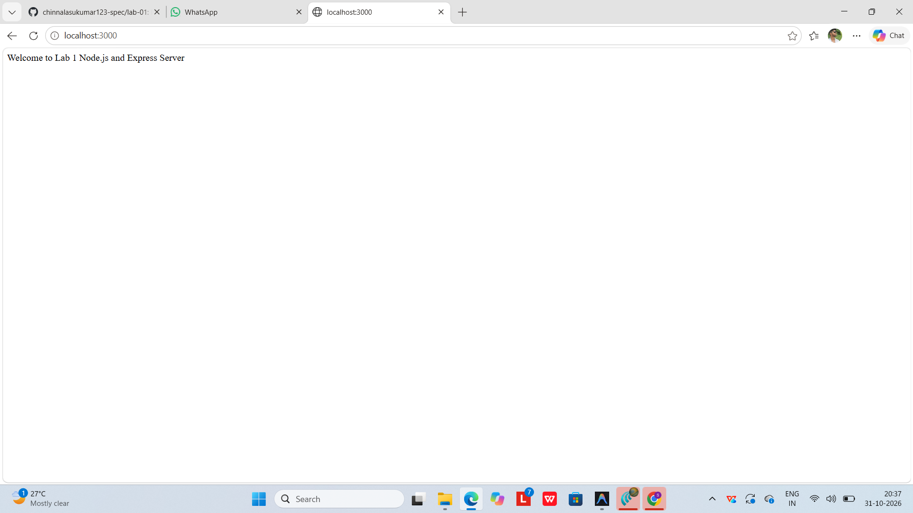
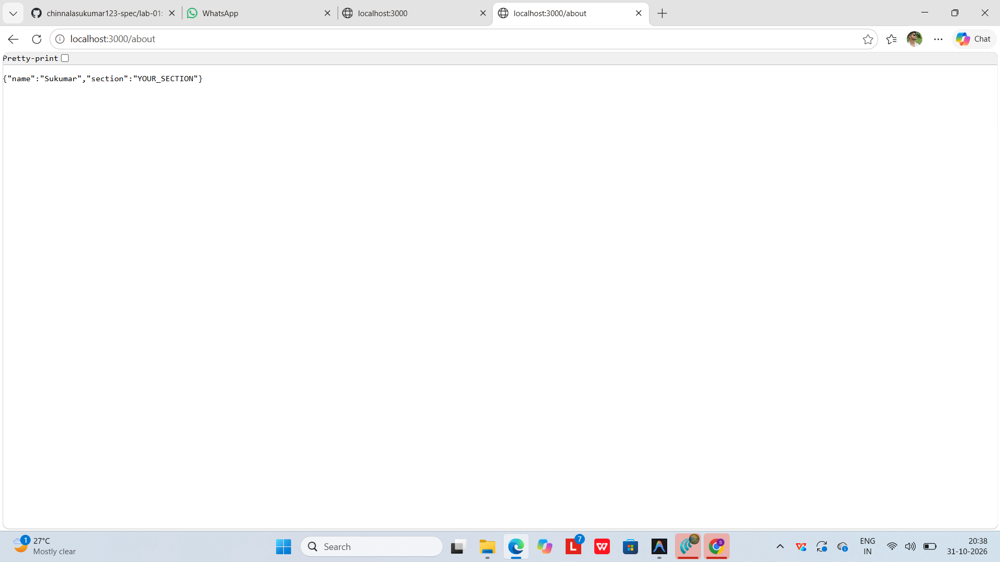
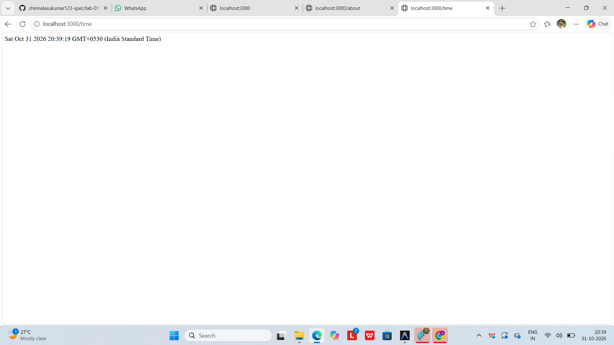
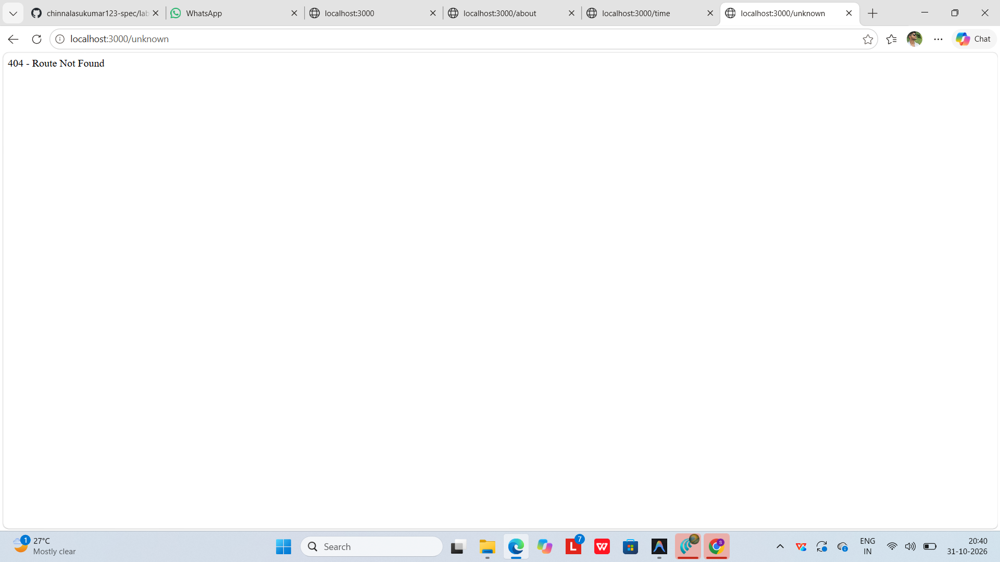

# Lab 1: Node.js and Express server

## Student Details

- **Name:** Sukumar
- **Registration Number:** [Your Registration Number]
- **Section:** [Your Section]

---

## Repository
- **Course Repository:** https://github.com/chinnalasukumar123-spec/collage-labs

---

## Live Link

Not deployed yet

---

## How to Run

1. Navigate to the `lab-01` directory:
   ```bash
   cd lab-01
   ```

2. Install dependencies:
   ```bash
   npm install
   ```

3. Start the Express server:
   ```bash
   npm start
   ```
   *(Alternatively: `node server.js`)*

4. (Optional) Run the plain Node.js HTTP server:
   ```bash
   npm run start:http
   ```
   *(Alternatively: `node server-http.js`)*

---

## Endpoints

| Method | Path | Description |
|---|---|---|
| GET | `/` | Returns the welcome message |
| GET | `/about` | Returns name and section as JSON |
| GET | `/time` | Returns the current date and time |
| GET | Any unknown path | Returns a 404 response |

---

## Screenshots

### 1. Home Route (`GET /`)


### 2. About Route (`GET /about`)


### 3. Time Route (`GET /time`)


### 4. 404 Route (`GET /unknown`)


---

## Notes

### Problems Faced and Solutions
- **Port Conflict Management:** Both the plain Node.js HTTP server (`server-http.js`) and the Express server (`server.js`) are configured to use port `3000`. To avoid port collision (`EADDRINUSE`), the servers are run independently rather than concurrently.
- **Git Hygiene:** Configured `lab-01/.gitignore` to ensure `node_modules/` and `.env` files are strictly excluded from version control.
